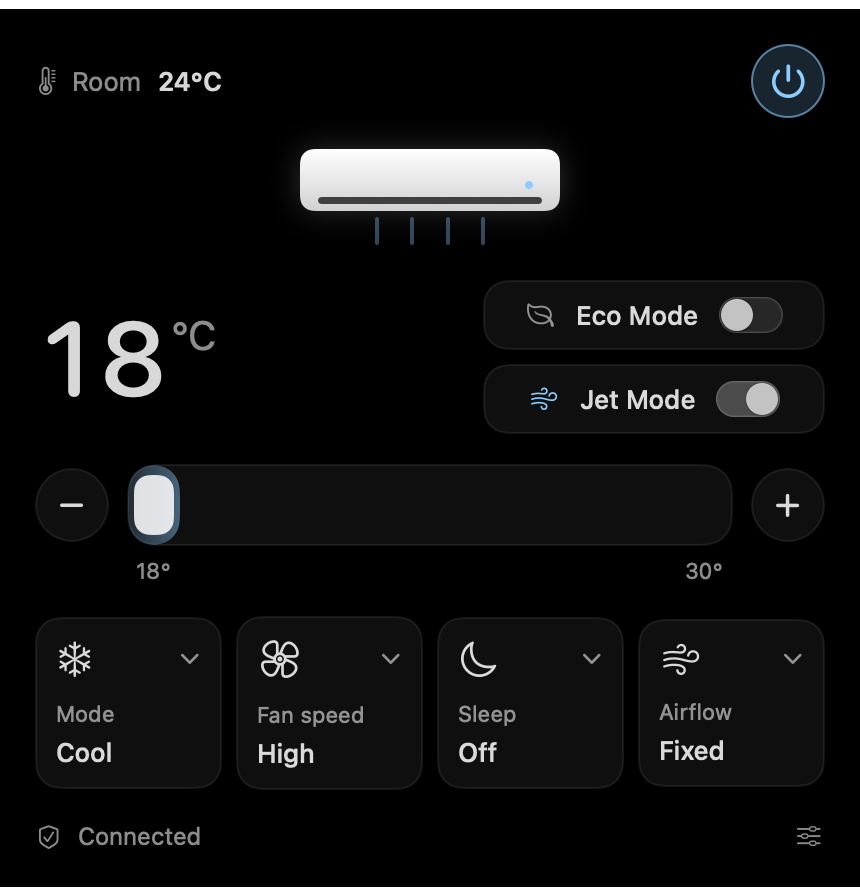
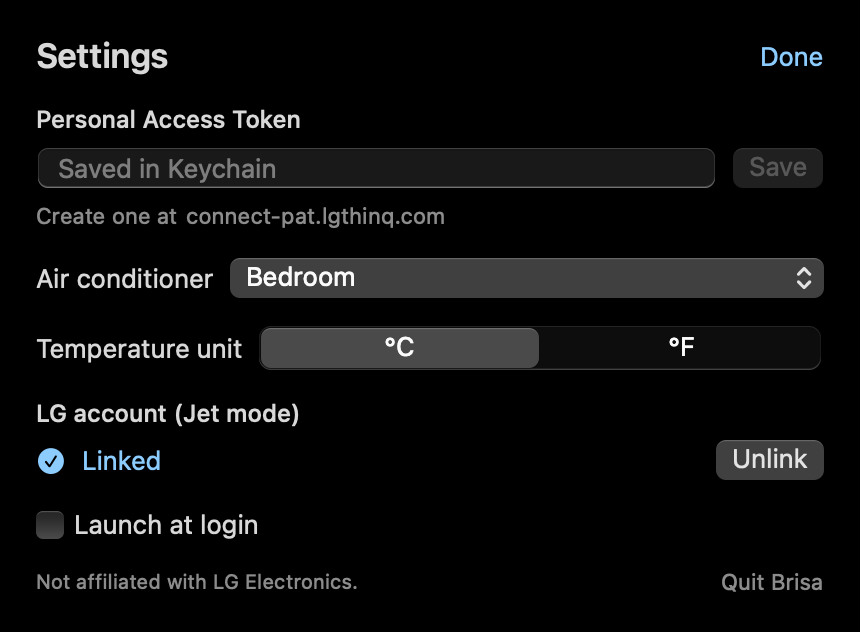

<p align="center">
  
</p>

<h1 align="center">Brisa</h1>

<p align="center">
  Your LG air conditioner, one click away in the macOS menu bar.<br>
  <sub>"Brisa" is Portuguese for <i>breeze</i>.</sub>
</p>

<p align="center">
  <a href="../../releases/latest"></a>
  
  
  
</p>

<p align="center">
  
</p>

No more picking up your phone and waiting for the ThinQ app to load just to drop the temperature a degree. Brisa lives in the menu bar, shows the room temperature at a glance and gives you every control in one click.

## Features

- **Everything in one panel** – power, mode, target temperature, fan speed, sleep timer and airflow direction
- **Real Jet mode** – the ThinQ app's turbo cooling, not an imitation. Brisa can even **keep Jet on**: the AC ends Jet after ~30 minutes, and Brisa turns it back on until you switch it off
- **Eco mode** for the nights you don't need an ice box
- **Glanceable** – `24°` right in the menu bar; the item only appears while the AC is running
- **Right-click to toggle power** without opening anything
- **Adapts to your unit** – only the controls your model actually supports are shown
- **Liquid Glass** look on macOS 26, a clean dark panel on older systems
- **English and Portuguese (Brazil)**, following your system language
- Tiny native Swift app, no Electron, no background services

## Install

1. Download `Brisa-x.y.z.dmg` from the [latest release](../../releases/latest) and drag **Brisa** into Applications.
2. Brisa isn't notarized (that needs a paid Apple Developer account), so macOS blocks the first launch. Open it once, then go to **System Settings → Privacy & Security** and click **Open Anyway**. Or in Terminal:
   ```bash
   xattr -dr com.apple.quarantine /Applications/Brisa.app
   ```

## Set up



**1. Connect your account (required)**
Sign in at [connect-pat.lgthinq.com](https://connect-pat.lgthinq.com), choose **Add new token**, select all scopes and copy it. Click the Brisa icon, paste it under **Personal Access Token** and press **Save**.

**2. Enable Jet mode (optional)**
LG's official API doesn't include Jet, so Brisa talks to the same service the ThinQ phone app uses. In Settings, click **Sign in…** under *LG account*: LG's own sign-in page opens in your browser, and when you finish, your browser hands the session back to Brisa.

> Use your LG **email and password**. "Sign in with Google/Apple" only works inside LG's phone app – if that's how you created your account, use *Forgot password* on LG's page to set one first.

**3. Optional:** turn on **Launch at login**.

<br clear="right">

## Using Brisa

| Action | How |
|---|---|
| Open the panel | Click the menu bar item |
| Turn the AC on/off | Power button in the panel, or **right-click** the menu bar item |
| AC is off and the item is hidden | Open **Brisa** from Spotlight (⌘ Space) – the panel opens |
| Change temperature | Drag the slider or use **−** / **+** |
| Keep Jet on | Toggle **Jet Mode** (AC on, Cool mode). It stays held until you switch it off or enable Eco |

Status refreshes every 5 minutes in the background, every minute while the panel is open, and every minute while Jet is held.

## Privacy

- Your token and LG session are stored only in the **macOS Keychain**.
- Brisa never sees your LG password – you type it on LG's page in your browser.
- Brisa talks only to LG's servers. No analytics, no third parties.
- `~/Library/Logs/Brisa.log` records sign-in redirects (with secrets masked) and Jet re-activations.

## How it works

| What | API |
|---|---|
| Status, power, mode, temperature, fan, Eco, sleep, airflow | LG's official ThinQ Connect API with a Personal Access Token |
| Jet mode | ThinQ v2 private API (the one the phone app uses), based on the excellent [homebridge-lg-thinq](https://github.com/nVuln/homebridge-lg-thinq) |

The private API is undocumented and may change without notice; if Jet stops working, everything else keeps going.

Tested with an LG Dual Inverter wall unit (`RAC_056905_WW`) on a Brazilian account. Other ThinQ air conditioners should work; Jet support depends on the model.

## Build from source

Requires the Xcode command line tools (Xcode 26 for Liquid Glass).

```bash
make run    # build Brisa.app and open it
make dmg    # build/Brisa-<version>.dmg
```

Pushing a `v*` tag builds the DMG on GitHub Actions and attaches it to a release. The README screenshots come from `Brisa --screenshot assets`, which renders the panels with sample data.

## License

MIT. Not affiliated with, endorsed by, or sponsored by LG Electronics. "LG" and "ThinQ" are trademarks of their respective owners.
